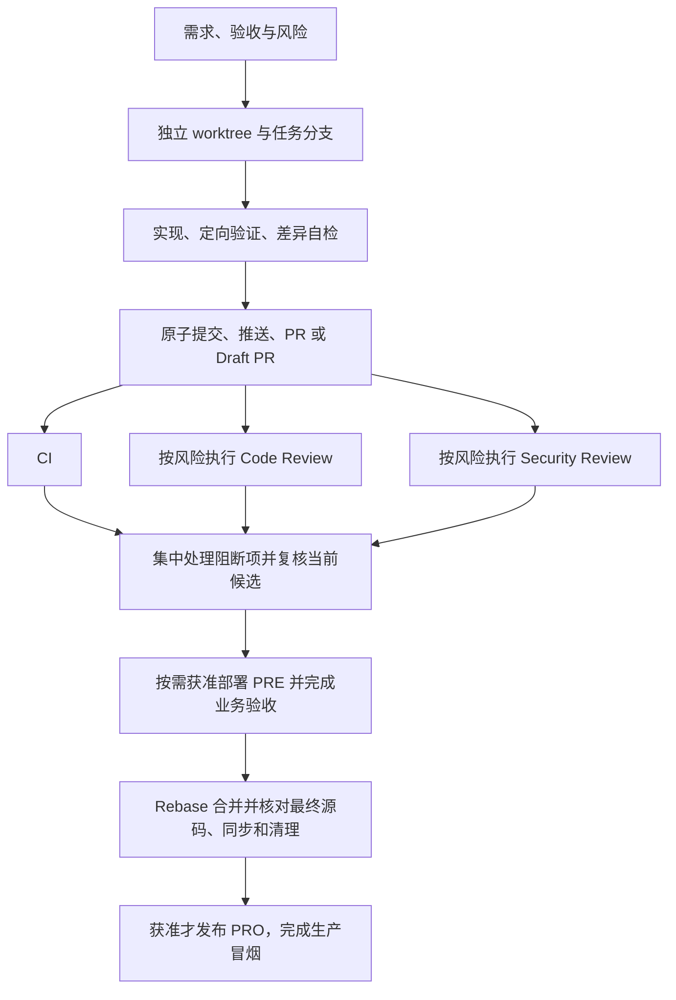

# FlareMail 研发工作流

以可复现的检查验证确定性行为，用独立 Review 判断正确性与风险，超出既有范围或授权的取舍由 Owner 决定。

提交前在本地验证受影响场景。初步验证完成即可开 PR，也可先用 Draft 保留任务状态并运行 CI。代码达到可审查状态再正式请求审查。实际执行步骤和安全清理命令见 [开发指南](DEVELOPMENT.md#worktree-and-pr-workflow)。远端操作按 [仓库授权](../AGENTS.md#默认开发工作流) 执行。

## 风险与质量门禁

按实际数据流、调用方和影响面定级。混合改动采用最高相关等级，影响未查清时保留较高等级。CI 的文件范围识别用于选择自动化任务，PR 记录的风险定级仍由实际影响决定。涉及授权边界、发布门禁或 CI/CD 信任的治理变更属于 R3。

| 风险 | 常见范围 | 定向及自动验证 | 独立 Review | PRE |
| --- | --- | --- | --- | --- |
| R0 | 普通文字、README、注释等非运行时改动 | 差异、必要链接或语法检查，轻量 CI | 通常无需 AI Review | 无需 |
| R1 | 局部样式、文案、只读展示 | 定向检查，按需类型和浏览器验证，CI | Code Review，本地独立审查可选，Security Review 按影响 | 按影响 |
| R2 | 普通功能、API、邮箱状态、跨组件交互、性能 | 定向和相关集成测试、CI 与构建、相关 E2E，影响横跨分组时扩大套件 | Code Review，涉及安全影响时加 Security Review | 正式 PRE 业务验收 |
| R3 | 认证、隐私、D1 结构或迁移、邮件收发及路由、Webhook、权限和绑定、发布与信任边界 | 完整相关测试、安全和异常路径、核心 E2E、CI、迁移兼容和回滚 | 必要的独立本地 Review、Code Review 和 Security Review | 业务验收，无法覆盖的路径需具体替代证据 |

CI 无法用普通 HTTP 覆盖的 Worker 事件需补本地隔离、合成事件或其他可审查的验证。对于无运行时的 R3 治理变更，流程演练和工作流验证是对应的替代路径。必需验收受阻时，保留候选，记录具体阻塞及证据，按既有授权提交 Owner 决策。

## Review 边界与轮次

- 提交前差异自检是每次开发的一部分。R0–R2 默认无需完整本地 `/review`。R3 要有必要的独立审查。高风险边界变化或大规模重写扩大审查面。修复后验证和审查受影响的差异。源码状态、基线和验证输入等价的证据可以复用。
- 代码达到可审查状态后并行观察 CI、必要 Code Review 和 Security Review。优先使用 GitHub App 当前自动触发配置。汇集同一轮反馈再集中修复。运行中不重复触发同类审查，升级到新 head 后逐项重新核对必要证据。合并时需要实际作者 `chatgpt-codex-connector[bot]` 针对当前 head 的各类完成记录，同时检查提交评论、行内意见和未解决线程。仅有摘要总状态、表情、历史提交的结论或空检查列表都不足以证明完成。参见 [Codex GitHub 配置](https://developers.openai.com/codex/integrations/github/)。
- 审查聚焦本次引入或明显放大的正确性、安全、兼容、数据完整性和回归问题。意见说明具体触发条件与实际影响。样式偏好、无关历史问题和假设性架构建议不阻断。对误报、历史问题和延期项记录依据。修复范围以原任务验收要求为准。

| 级别 | 处置 |
| --- | --- |
| P0 | 严重安全、泄露或数据丢失，阻断 |
| P1 | 重大功能错误、安全边界破坏或核心回归，阻断 |
| P2 | 普通缺陷与边界问题，按验收和实际风险决定 |
| P3 | 维护性或轻微优化，默认记录并延期 |
| Suggestion | 需要时记为后续事项 |

有效性与阻断性分别记录。验收、认证、隐私、数据完整性及生产稳定性风险按实质判断。R0 通常 0 轮完整 AI Review，R1 为 1–2 轮，R2 为 2–3 轮，R3 三轮未收敛时提交 Owner 仲裁。一次集中接收和修复周期计一轮，并行的两类 Review 不分别计数。超预算时停止自主扩修，保留 PR、分支和证据，列出阻断项、根因、影响及拆分或修复选择。未处理的阻断项、当前提交所需的 CI 或 Review 缺失时仍不得合并。

## CI 和仓库门禁

- `CI` 对所有 PR 运行，包含 Draft PR。普通 Markdown 差异使用轻量路径。运行时或关键流程文件变更使用三组 Bun 测试、类型、生成声明、公开目标 Worker dry-run 及 Chromium 的 `@ci-core` 用例。现有测试分组覆盖断言会检查遗漏和重复。依赖定义或锁文件变化时执行依赖审计。直接推送 `main` 时按完整推送区间检查。PR 改目标分支会重新验证集成内容，单纯更新标题或正文不会发布新的 `CI gate` 结论。
- 默认 PR checkout 验证 GitHub 生成的测试合并提交。每个候选记录 PR head、base 和 CI run，核对最新集成结果。合并前基线变化时，重新确认 CI 确实验证新集成结果。旧跑次和被撤销的跑次不可复用。相同 PR 的旧 CI 自动取消。每次 main 推送保留独立跑次，以便该范围的依赖审计完成。
- 主分支更新和手动运行覆盖 WebKit、Firefox 和无障碍测试。在 PR 上按风险用本地独立场景补足适用引擎与视口。仅用 mock/demo、合成数据及隔离状态。各 CI job 在不同 runner 上安装锁定依赖和工具，共享生成目录的步骤在同一 job 串行。浏览器失败的合成诊断保留五天。需要重跑时重启整个 CI job，让 Worker 从独立的 D1/R2 fixture 开始。
- PR 的 `CI gate` 汇总所有必要结果，计划、取消、失败和非预期跳过会阻断。合并前验证当前 PR 的实际集成结果。主分支及手动跑次分别使用 `Main CI gate` 和 `Manual CI gate`。普通 PR job 仅给 `contents: read`，不保存 checkout token，也不使用部署凭据。远端 PRE/PRO 均不由 CI 自动触发。
- `Release security` 每周、手动或 Release 发布时验证锁定依赖。PR 的依赖变化审计用于该候选，发布扫描和本地发布前审计各记录对应版本。GitHub App 安全审查独立于这些检查。

PR 可以修改它所运行的 CI 定义和脚本。GitHub Actions 来源与同名状态只能证明有对应结果。涉及 `.github/workflows/`、`.github/actions/`、测试分组或验证入口脚本的门禁改动均为 R3，合并前由 Owner 独立核对当前 head 的门禁差异并记录明确批准。未获批准时保留 PR。若计划和权限支持，可以另外由 Owner 选用独立受保护来源提供的必需工作流。

需要 Owner 启用仓库级强制执行时，在 GitHub **Settings → Rules → Rulesets → New branch ruleset** 建立针对默认分支的规则，要求通过 PR 和 GitHub Actions 的唯一 `CI gate`，开启最新基线要求，在可用时选定 GitHub Actions 来源。避免添加单人仓库无法满足的人工审批。核对该检查在合并基线变化后重新出现。若采用 merge queue，先补 `merge_group` 触发再启用。操作见 [GitHub rulesets](https://docs.github.com/en/repositories/configuring-branches-and-merges-in-your-repository/managing-rulesets/creating-rulesets-for-a-repository)。不要用管理员参数绕过门禁。在 [Codex Code review 设置](https://chatgpt.com/codex/cloud/settings/general) 选择 FlareMail，核对 **Review code → Automatic review** 与 **Review security vulnerabilities → Auto security review**。选择适用的 PR 和触发条件，以真实 PR 的两类记录和 SHA 为准。若需要两类自动并发，可选择 **Trigger → Whenever code review runs**。如果 GitHub 未提供对应强制检查，保留合并前的人工或代理核对。

## PRE、PRO 和证据复用

- DEV 使用独立 D1/R2 及合成邮件。PRE 是稳定候选的业务验收环境。提前远端调试须有理由和授权，并单独记录。正式 PRE 在必要 CI、Review 和阻断项处理完成后进行。维护独立存储、访问认证及候选占用控制，按 [PRE 指南](PREVIEW.md) 操作。
- PRE 记录候选 SHA、树 SHA、版本标签、锁文件、构建工具和目标配置的脱敏标识、部署 ID、URL、实际用例和未覆盖项。先检查运行版本与授权，再结合认证后就绪和业务场景验证。只改非构建文档时，确认原候选仍运行、相关构建输入等价并记录差异，才复用证据。代码、依赖、构建配置、安全、绑定或数据库行为变化时重新接受受影响场景。
- 原生 PRE 与 PRO 使用各自的绑定和发布标签。现有做法按源码树和构建输入核对等价性。未经实际验证的跨环境产物提升不使用。Rebase 改变 SHA 时比较代码树、构建输入和版本标签。若基线改变了候选结果，重跑受影响的检查和 PRE。
- 合并后按单独授权及 [生产清单](PRODUCTION_CHECKLIST.md) 核实最终输入、审计、迁移兼容与回滚，发布后执行相应生产冒烟。Worker 版本与 D1 数据恢复是两项独立操作。

## 任务记录与度量

每个 worktree 创建 Git 忽略的 `.task/task.md` 和 `.task/progress.md`。

- `task.md` 记录 ID、原始需求、目标、范围、非目标、验收、完成标准、风险、基线 SHA、分支、worktree 和授权。
- `progress.md` 记录阶段、已做和未做的事、head、测试结果、Review 轮次和问题处置、PRE 证据及下一步。
- 在关键阶段、提交、PR、测试结果、审查、集中修复、PRE 或暂停交接时简要更新。压缩或恢复时，先读两份文件，核对分支和远端事实。跨机器的记录可保存在 Issue 或 PR 正文，更新进度无需新建 Git 提交。清理前转存仍须保留的证据。禁止记录密钥、真实邮件或生产数据。
- 从任务和 PR 时间戳记录需求到交付时间、开 PR 到合并时间、CI 时长。用进度记录审查轮次、阻断项、PRE 部署及上下文恢复次数。用生产发布/事件记录回归比例（有回归的发布数除以发布总数）和从确认失败到验证恢复的用时。需要比较时注明日期范围及分母。

## 完成标准

验收项已实现，范围未扩大。适用的本地检查、CI、当前候选审查和 PRE 门禁通过，无未处理的阻断项。延期项、迁移、兼容、回滚和未覆盖范围有记录。状态能够跨会话恢复，授权内 Git 与发布步骤已执行并验证。达到要求即结束。

交付状态依次区分 **开发完成**、**可合并**、**已合并**、**生产可发布**、**生产已部署**、**生产已验证**。生产状态以单独的发布和运行证据为准。
