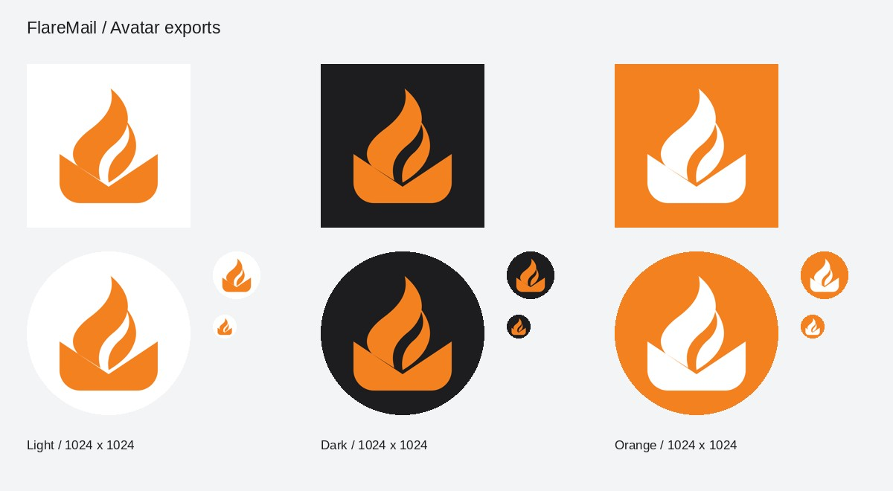

# FlareMail Logo 下载 / Logo downloads

[中文介绍](../../README.zh-CN.md) · [English overview](../../README.md) · [设计来源 / Design sources](../design-concepts/flaremail-logo/README.md)

沿用现有火焰与信封标志。**Telegram 头像推荐使用 [橙底白标 JPG](./flaremail-avatar-orange.jpg)**，下载后即可手动上传。头像均为 1024 × 1024 方图，图形居中并保留圆形裁切空间；上传时保持完整画面，避免再次放大裁切。

Uses the existing flame-and-envelope mark. For a Telegram profile photo, download the **[white-on-orange JPG](./flaremail-avatar-orange.jpg)** and upload it manually. All avatars are 1024 × 1024 squares with room for a circular crop. Keep the full frame when uploading.

## 头像 / Avatars

| 配色 / Color | JPG：直接上传 / Upload | PNG：无损 / Lossless | SVG：矢量 / Vector |
| --- | --- | --- | --- |
| 橙底白标 / Orange | [JPG](./flaremail-avatar-orange.jpg) | [PNG](./flaremail-avatar-orange.png) | [SVG](./flaremail-avatar-orange.svg) |
| 白底橙标 / Light | [JPG](./flaremail-avatar-light.jpg) | [PNG](./flaremail-avatar-light.png) | [SVG](./flaremail-avatar-light.svg) |
| 深底橙标 / Dark | [JPG](./flaremail-avatar-dark.jpg) | [PNG](./flaremail-avatar-dark.png) | [SVG](./flaremail-avatar-dark.svg) |

JPG/PNG 头像使用不透明背景，避免上传平台对透明区域的处理影响效果。SVG 适合继续编辑，不作为头像上传首选。

Avatar JPG/PNG files have opaque backgrounds so their appearance does not depend on how an upload service handles transparency. Use SVG for editing.

## 通用 Logo / General-purpose logos

| 资源 / Asset | 透明 PNG / Transparent PNG | SVG 源文件 / SVG source | 矢量 PDF / Vector PDF |
| --- | --- | --- | --- |
| 独立图标 / Mark | [1024 × 1024](./flaremail-mark.png) | [SVG](../../static/brand/flaremail-mark.svg) | [PDF](./flaremail-mark.pdf) |
| 横版 Logo / Horizontal lockup | [2288 × 512](./flaremail-logo.png) | [SVG](../../static/brand/flaremail-logo.svg) | [PDF](./flaremail-logo.pdf) |

透明图标适合叠加到设计稿；横版 Logo 的深色文字适合浅色背景。PDF 适合排版及打印，仍使用原有 RGB 品牌颜色，不是专色/CMYK 印刷文件。PNG/PDF 横版导出使用 Arial 的本机替代字体 Liberation Sans；SVG 继续保留原有字体回退列表。

Use the transparent mark in designs and the horizontal lockup on light backgrounds. PDFs are suitable for layout and printing, using the original RGB colors rather than a spot-color/CMYK print profile. The horizontal PNG/PDF exports use Liberation Sans as the local Arial substitute; the source SVG retains its existing font fallback list.

## 整包下载 / Download everything

**[下载品牌资源 ZIP / Download brand kit](./flaremail-brand-kit.zip)**：包含以上头像、透明 PNG、原始 SVG、矢量 PDF、预览及中英文使用说明。

在 GitHub 文件页面下载时，选择 **Download raw file**（或先打开 **Raw** 再保存），避免保存成网页。也可下载 ZIP 后一次解压全部文件。

On a GitHub file page, choose **Download raw file** (or open **Raw** before saving) to download the actual image. Alternatively, download and extract the ZIP.

## 导出记录 / Export notes

- 原始图形 / Artwork source: `static/brand/flaremail-mark.svg` and `static/brand/flaremail-logo.svg`; signature orange `#F48120`, graphite `#1D1D1F`, white `#FFFFFF`.
- 头像构图 / Avatar layout: `viewBox="0 0 100 100"`, opaque background, original 64-unit mark transformed by `translate(10 10) scale(1.25)`. Only the orange-background variant changes the mark fill to white.
- 导出 / Rendering: CairoSVG 2.9.1 for PNG/PDF; Pillow 13.0.0 for JPG at quality 95 with no chroma subsampling. These were temporary export tools, not project dependencies.
- 检查 / Checks: decoded dimensions, PNG transparency, opaque avatar backgrounds, circular crop clearance, SVG XML, PDF signatures, ZIP CRC/content, relative links, and visual inspection of full-size and small previews.
- 范围 / Scope: downloadable documentation assets only; application Logo, favicon, runtime, configuration, and Telegram account settings are unchanged. No deployment is needed to download these files from the repository.
