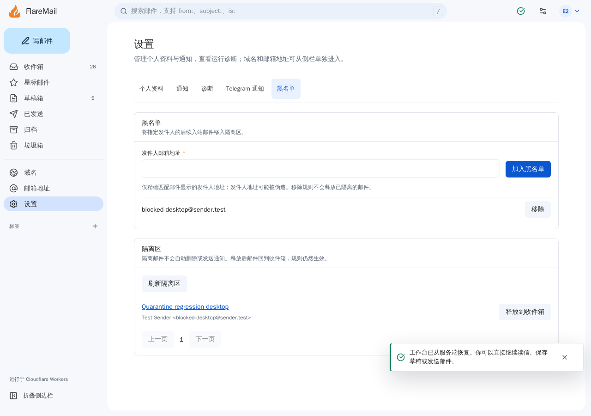

# 入站发件人黑名单与隔离区 Spec

状态：本地实现与验收；不代表 Preview、远程迁移或真实邮件验收。
基线：`origin/main` 的 `cfda03cb796941384404dae24dc01ad1651bd963`。

## 可行性与项目契合度

FlareMail 是 Owner 自托管邮件工作区，已在入站 Worker 解析邮件并持久化 D1/R2，适合在这一流程中按 Owner 配置筛选，无需新服务、外部黑名单或把邮件内容发送给第三方。现有垃圾箱用于删除和永久清空，并非垃圾邮件文件夹；隔离邮件需要独立状态，避免误删。保留原信、手动释放和明确说明误判风险，符合项目对邮件可靠性、隐私和 Owner 控制的约束。

用户确认范围为入站发件人；匹配的后续邮件进入可恢复的隔离区。第一版使用完整邮箱地址精确匹配，不支持通配符、域名规则、自动分类、第三方信誉或批量回溯处理历史邮件。

## 规则与匹配

- 规则由当前 Owner 管理，对其所有托管收件地址生效；新增、列表和移除需要既有认证与 CSRF 保护。地址沿用项目的邮箱校验和小写规范化，同一 Owner 重复添加幂等。
- 按用户看到的 MIME `From` 地址匹配，缺失时使用 SMTP envelope sender；不匹配显示名称、Reply-To、收件人或域名后缀。`From` 头存在但无效时不回退到 envelope；无法提取地址时显示未知发件人；没有线程头的新邮件按邮件分别归并。缺失或无效地址不匹配；大小写和首尾空格不影响匹配。历史邮件缺少发件人且没有有效线程标识时分别显示；共享旧会话键的批量扩展会被拒绝，可继续逐封操作。
- `From` 可被伪造，黑名单是整理工具，不是身份认证、反垃圾或安全边界；变更地址的发件人仍可能进入收件箱。只有送至本 Worker 且通过现有收件身份校验的邮件才会处理。
- 只对匹配时的后续入站投递生效：添加规则不移动历史邮件，移除规则不自动释放已经隔离的邮件。并发修改以该次处理读取到的规则为准。

## 隔离与恢复

- 邮件原文、正文、附件和 D1 记录仍按现有事务、去重及失败处理保存；隔离状态与邮件元数据在同一 D1 batch 中写入。重复投递不重置或重新隔离已经释放的邮件。
- 隔离邮件不出现在收件箱、归档、星标、标签、旧版兼容邮件列表或其计数和普通搜索结果中，也不触发邮件通知、Telegram 通知或自动回复。它不进入垃圾箱，不自动删除；Owner 可在隔离区查看并逐封释放到收件箱。
- 释放只改变该封邮件的隔离状态，不移除发件人规则；移除规则只影响后续投递。隔离列表、查看和释放仅允许当前 Owner 操作，分页不读取正文，前后游标均限定 Owner。
- 规则读取失败时记录不含地址和正文的稳定事件，继续原有收信路径，避免把异常当成成功丢信；此时邮件可能进入收件箱。邮件持久化错误仍遵循现有失败和回滚逻辑。

## 接口、界面与迁移

设置页新增“黑名单”标签，管理地址并显示可分页的隔离邮件列表；入口同时提供明确的释放操作，规则和释放状态在打开的标签页间同步。界面覆盖中英文、键盘与窄屏；认证失效时取消并丢弃旧会话请求，保留未提交的输入。隔离区通过双向游标及索引分页，失败后可重试原目标，打开阅读页后返回原分页并可继续向前翻页；当前分页被清空时回到第一页或重新填充。写入失败时保留错误与原操作，供用户核对后重试。阅读页按数据库隔离状态提示先释放再回复或转发。

使用追加 D1 migration 增加 Owner 黑名单表和入站邮件状态字段，同步 schema 快照、版本、readiness 和迁移测试；不引入绑定、云资源或依赖。已有邮件默认非隔离，旧记录和 R2 原文不变。上线前核对迁移清单和恢复点，先发布兼容 schema 28 与 29 的桥接版本，再执行 0029 并发布黑名单版本；桥接版本作为保留 D1/R2 的代码回退目标。回退期间黑名单停用，隔离邮件可能出现在普通邮箱，直到恢复黑名单版本。PRE 与生产共用 D1，未经明确授权不得迁移共享数据库；HTTP PRE 也不能证明实际 `email()` 验收。

## 验收

- 覆盖添加、重复、移除、格式无效、Owner 隔离、会话保护、分页游标和释放；原邮件与附件保留，错误不泄露地址或内容。
- fake D1/R2 覆盖命中/未命中、大小写、头部与 envelope 差异、没有发件人、重复投递、隔离期间通知及自动回复、规则读取失败、存储失败和释放后恢复正常收件。
- 覆盖普通视图、搜索、星标/标签、计数和线程批量操作不会混入隔离邮件；释放后可以再次读取。
- 验证空库、legacy fixture、schema 快照一致性；运行 `bun run test`、`bun run check`、`bun run build`，并在隔离本地状态上验证桌面、手机、窄屏及键盘/可访问性。
- PRE 页面/API、真实 Email Worker、真实邮件投递和远程迁移分别记录；未执行时不得记为通过。

## 本地验证记录

2026-11-09，在独立 worktree 使用 Bun 1.4.4、cf 1.0.0-beta.27 和隔离本地 D1/R2：

- `bun run test`：710 项通过；`bun run check`：0 错误、0 警告；`bun run build` 与 `bun run deploy:dry-run`：通过。
- Playwright Chromium：桌面、手机与 320px 窄屏的设置标签、本地 Worker 隔离闭环、加载/会话竞态、四页反向导航、空页回退、浏览器历史、跨页面同步及写入失败重试共 27 项通过；分页兼容性修复后模拟浏览器缺少 `URLSearchParams.size` 的三种视口均通过，后续同步及错误提示修复的 15 项受影响场景也通过。使用合成邮件和本地 `/cdn-cgi/local/email`，覆盖不同 MIME From 与 SMTP envelope sender、保存、查看、释放、规则移除、刷新、键盘和 axe 检查；不涉及真实邮件。
- 七轮本地 Codex 审查提出的旧版列表过滤、无效 From 回退、显示和线程归并、过期会话请求、分页恢复及重试、空页导航、查询索引、旧浏览器分页兼容性、写入失败提示、阅读页隔离状态及跨页面同步问题均已修复，并增加回归覆盖；最终提交的审查结果以交付记录为准。
- Firefox 缺少宿主图形库，临时补库后进程仍以 SIGSEGV 退出；WebKit 缺少 GStreamer 等宿主库，无法启动。两者未通过验证，Linux WebKit 也不能代表真实 iOS/Safari。Browser 插件不可用，故按仓库现有 Playwright 流程执行。
- 未执行远程 Preview、远程迁移、生产部署、真实供应商投递或接收。当前共享生产 D1 的 Preview 不适合直接进行此 schema 升级验收；须先获授权并解决隔离环境。
