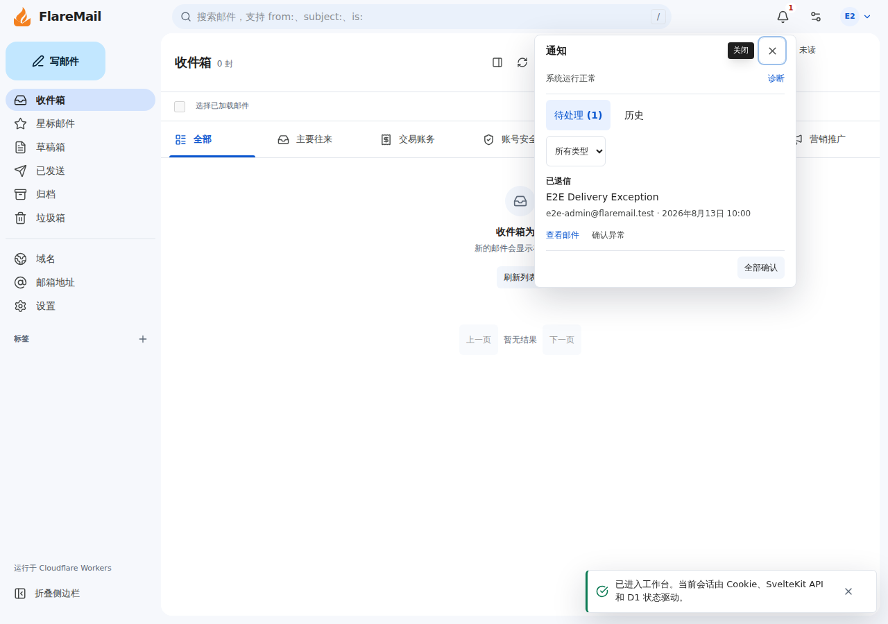

# 投递异常关注与通知生命周期

工作区顶部铃铛汇总整个 Owner 的待处理投递异常。侧栏只显示当前身份的未读收件和草稿。已发送列表保留真实投递状态，并可筛选待处理异常。

| 状态 | 依据 | 确认异常的效果 |
| --- | --- | --- |
| 系统健康 | 已认证 Worker 的配置、D1 schema/访问、R2 只读探测及已配置的收信归属依赖 | 无 |
| 投递状态 | 已持久化的发送尝试、投递状态和供应商事件 | 无 |
| 投递关注 | 单封邮件当前有效的投递异常及 Owner 处理历史 | 徽标减少，异常进入历史 |

系统检查区分正常、降级、未知与检查中。检查只验证应用和直接依赖，供应商可用性以 Settings 中已有的域名检查为准。普通网络失败保留未知或最近已证实的降级。确认投递异常没有外部 API 调用，也没有重试、投递或已读写入。

## 生命周期

- queued、正常 submitting、submitted、sent、delivered 不产生异常。提交超过原有 15 分钟超时规则后，才产生提交超时提醒。delayed、failed、bounced、complained、suppressed 直接产生关注记录。
- 每次异常阶段生成独立 ID。相同尝试和类型的重复状态更新沿用原记录。供应商 webhook 仍按现有签名、去重、顺序及终态规则处理。
- 打开通知或读取邮件只查看。确认转到 acknowledged，仍有效的已确认异常可以重新打开。重新打开生成新版本，较早的确认请求不能再作用于这一版本。
- 投递恢复关闭异常为 resolved。投递延迟在实际送达或后续尝试获发新供应商邮件 ID 时恢复。收到同一 ID 的发送事件或幂等接受回执会保留延迟提醒。等待重试时保留前次失败关注，直到新尝试成功进入正常状态或自己产生异常。
- 异常升级、重试产生的新异常和超时取代先前的异常时，旧阶段保留为 superseded，新阶段单独提醒。重试由既有资格和服务端幂等保护控制。
- 软删除的邮件从待处理和历史列表中隐藏。还原重新显示原有关注状态，且废止删除前的操作版本。永久删除通过外键级联清除该邮件的关注记录。

## D1 与并发

`0033_delivery_attention.sql` 建立关注记录、Owner 和类型分页索引、待处理部分索引、单调版本计数器及事务内触发器。触发器从已接受的投递状态变化维护记录，新旧状态在同一 D1 写入事务内生效。提交超时用资格时间派生，超过阈值即在下一次读取时出现，不需后台扫描。重试仍在进行时，较早的异常保持有效至新提交达到超时阈值；到时新异常成为唯一可处理记录。同一供应商 ID 获得幂等接受后，仍未解决的供应商延迟重新可见，保留确认状态并更新异常版本。本地限流等提交异常单独处理，提交成功后关闭。供应商明确报告投递失败时，普通的同键重试无法恢复该投递。

历史初始化从仍存在的 Sent 邮件及当前投递状态导入当前异常。`0034_delivery_attention_backfill.sql` 从同一次尝试的时间线补齐后来仅变为已发送的延迟异常。`0035_preserve_replayed_delivery_delay.sql` 保留同一供应商邮件 ID 在幂等重试前已有的延迟异常，在提醒表记录延迟的供应商 ID，并用旧事件补齐有相同 ID 的早期尝试。已经结束的早期事件保留在原投递时间线。通知投影只返回有界主题、发件身份和日期，无正文或附件读取。D1 单条确认比较 Owner、事件 ID、版本、当前有效性和状态，重复确认返回零次写入。批量确认按服务端列表或摘要返回的 Owner 快照上界选择有效待处理记录，使用版本和资格时间排除后来新增、恢复可见、重新打开或刚达到超时的异常。确认和 webhook 之间由 D1 事务排序。现有定时任务每次最多补放四个已关联 Resend ID，每个最多四条事件，以恢复暂时失败的同步。工作区用已认证的 POST 刷新通知摘要，也在当前 Owner 范围内尝试同样的有界补放，以支持没有定时任务的 PRE。自重试开始 15 分钟仍没有结果时，可以补放已知供应商 ID 的事件。较早尝试的迟到结果保留在历史，当前状态与回执沿用最新尝试。 旧版未关联事件如只匹配已保存的一个早期投递，时间线也会呈现该事件。供应商的第一条实际延迟会开启新的提醒，即使本地提交限流已确认。发送确认与 webhook 入库都会在原事务内标记已找到对应投递记录的早到事件。`0036_recover_pending_resend_events.sql` 为已标记的待补放记录添加部分索引，并补齐同一供应商 ID 在重试开始后、接受回执入库前已经收到的历史延迟。`0037_recover_sent_resend_delays.sql` 补齐随后收到同一供应商 ID 的已发送事件、仍然没有终态的历史延迟。`0038_queue_legacy_resend_events.sql` 将已能按供应商 ID 关联的旧版未匹配事件加入补放队列。`0039_queue_legacy_resend_failures.sql` 将被同一 Resend ID 的重试接受回执覆盖的失败事件加入补放队列。

`0040_recover_masked_resend_terminal_events.sql` 在迁移中直接恢复同一 ID 在旧版重试中被接受回执覆盖的状态和回执，包含退信、投诉、抑制、失败和已送达。重试中的首个终态类型以事件入库顺序为准，随后同类型取最新供应商时间。重试开始后没有终态时，使用前一次接受回执之后的顺序。缺少可定位的前次回执时，仅补放类型一致的记录。重试开始的墙钟时间无法确定同一毫秒或跨请求竞态的实际入库先后，冲突记录仍可核对原始时间线。提交超时按完整的毫秒时间计算。

`0041_recover_terminal_outcomes_across_retries.sql` 在早期接受和最新接受之间存在未确认重试时，补齐同一 Resend ID 的明确终态。若旧版超时回执重置投递状态，使用入库顺序选取重置后实际生效的终态类型。对可确定被 0040 误恢复的终态，保留原始事件并恢复后一次接受和其后的有效进展。

`0042_correct_stale_legacy_failure_receipts.sql` 修正旧版在中间重试的本地提交失败后忽略的同 ID 失败 webhook。仅在原始时间线和当前回执能确定它被误选时，恢复先前有效失败的回执和提醒时间，保留失败状态、确认记录和原始事件。

旧时间线记录供应商事件和入库顺序，未记录每个事件是否成功改写状态。待重放事件与实时事件并发时，不同生效顺序可能留下相同记录，0034 和 0035 的历史补齐可能保留多余提醒或漏掉历史提醒。Owner 可以核对投递时间线。运行中的新事件按实际状态变更更新关注记录。

## API 与前端刷新

见 [API 契约](../API.md#delivery-attention)。首次进入已认证工作区加载一个轻量摘要及独立系统检查，弹窗打开后才查待处理列表，历史由显式切换加载。两类读取均有 30 秒的新鲜度窗口，通过窗口聚焦、显式刷新以及影响投递的操作同步。确认后应用服务端计数和列表变更，随后按需重新读取打开的弹窗、Sent 关注筛选或当前详情。取消在途旧请求，跨标签页只广播变更信号。认证过期取消读写等待，恢复会话后重新读取。

通知定位使用现有邮件深链接和浏览器历史。跨身份通知先进入 Owner 范围的 Sent，浏览器返回可恢复原邮箱视图。工作区详情和独立阅读页的投递回执共用确认与重开接口。待处理、历史、类型选择、确认、重开和刷新均可用键盘操作。Settings 的原始投递指标使用独立的 Owner 范围缓存。

## 迁移与回退

Worker 使用精确 schema 版本。新版本需要 schema 42。隔离 PRE 按顺序应用 0033 至 0042 中仍未记录的迁移，再执行登录及异常端到端验收。共享数据库上的所有 Worker 入口需协调切换，包含收件和 webhook，生产另行授权。

生产升级前核对当前 D1、所有写入端、数据量、可恢复的 Time Travel 书签或受保护快照。验证一个兼容 schema 42 的回退 Worker，或安排可控的迁移与版本切换窗口并明确中间写入边界。只回退代码时保留 schema 42 和投递历史。恢复旧库会丢失书签后的写入，需先核对影响并另行授权。

## 本地验收路径

`bun install --frozen-lockfile`、`bun run test`、`bun run build`、`bun run check`。数据库测试覆盖空库、历史回填、快照、归属、生命周期和竞态。Playwright 的 `delivery-attention.spec.ts` 使用隔离 Worker、D1/R2 和签名的合成 Resend webhook，覆盖跨身份、跨标签页、真实状态保留、系统降级和恢复、鉴权及界面交互。浏览器证据涵盖 Linux 浏览器与模拟视口。PRE、生产及真实供应商验收独立记录。
