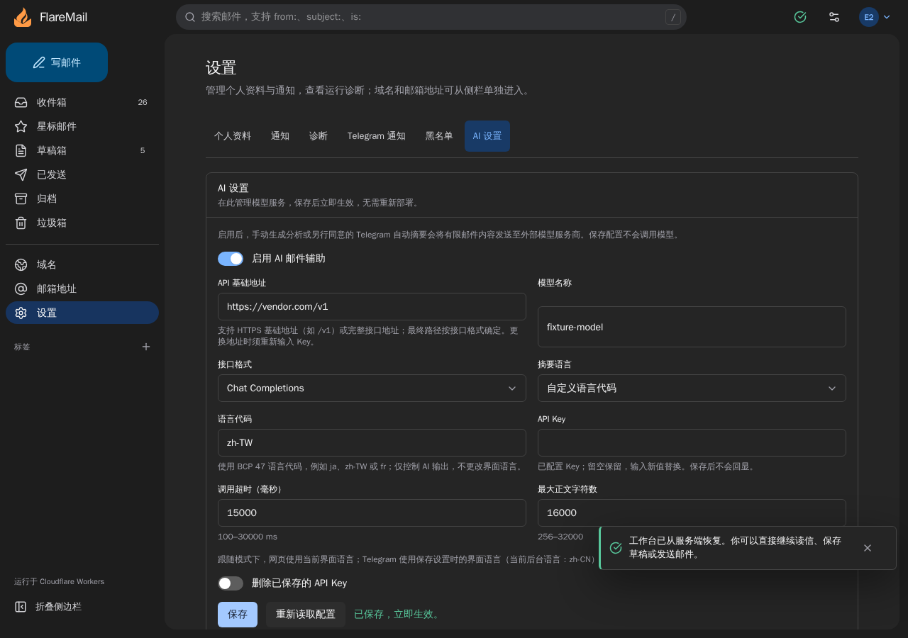
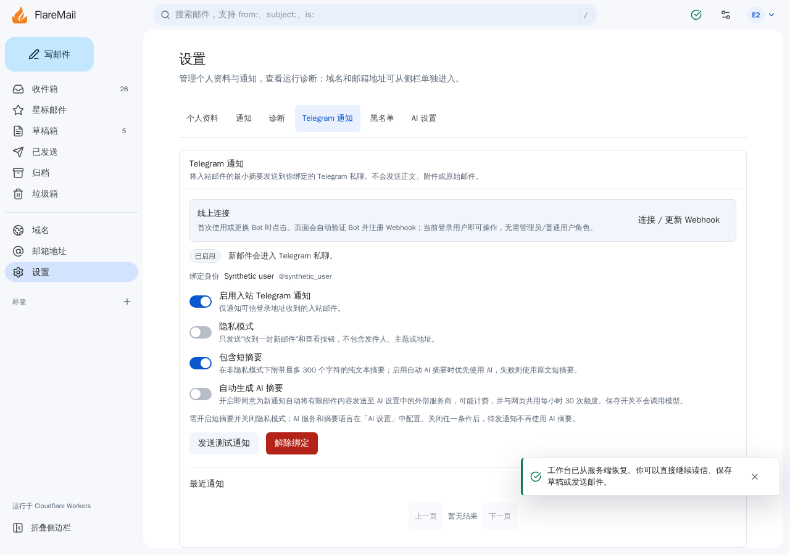

# AI language and Telegram summary acceptance — 2026-11-12

[SPEC](../specs/ai-language-and-telegram-summary.md) · [AI guide](../AI.md)

## Scope and source

- Base: `8457cd9b0c94819f7b1c2ada582c070a5bb2bb13` (`origin/main` at task start).
- Branch: `feat/ai-language-telegram`.
- Worktree: `/tmp/FlareMail-ai-language-telegram`.
- Three subagents implemented AI settings/provider/cache, Telegram outbox/API/schema,
  and UI/i18n/browser coverage. The primary agent integrated the changes and docs.
- No dependencies, provider credentials, production bindings or real messages are
  included in the change. Local provider and Telegram requests use synthetic fakes.

The final commit and built-in local review head/time/result are recorded in the
handoff evidence, outside the reviewed tree so recording a review does not change
the head it verifies. PRE acceptance and both current-head bot reviews remain
separate gates before PR/merge.

## Local acceptance

- `bun run test`: **892 passed**, 0 failed, 5266 assertions, 120 files. This includes
  migration/snapshot checks, language and cache behavior, provider formats, permission
  changes, AI fallback/attempt limits and concurrent partial-setting updates.
- A simulated 46-second lease overrun preserves the retryable processing row;
  the next dispatcher reclaims it and sends the ready cache with one AI attempt.
- The concurrent-setting regression was reproduced before fixing it: unrelated
  summary/privacy saves could restore an explicitly disabled AI or notification
  switch. Three concurrent PATCH tests fail before and pass after atomic SQL updates.
- Chromium desktop, mobile and 320px narrow: full relevant AI suites passed; settings
  and axe were repeated after the shared Select label color fix.
- Linux WebKit desktop and Firefox desktop: relevant AI suites, settings, keyboard,
  axe and console checks passed. Desktop-only focused-reader/theme cases retain
  their existing project skips; the Chromium desktop cases passed.
- `bun run check`: 0 errors / 0 warnings. `bun run build` and public
  `bun run deploy:dry-run` passed. Modified-document local links and diff whitespace
  checks passed. Final built-in review command logs and exact status are retained
  with the handoff evidence.

The Browser plugin is not available; the repository's Playwright workflow was used.
Browser startup initially needed cf cache permissions and WebKit/Firefox system
libraries. Large synthetic runtime fixtures were also archived off the temporary
filesystem after a local SQLite-full startup failure. These environment issues
were resolved and affected suites rerun.
The WebKit contrast failure led to an explicit theme color on Select labels,
matching the existing TextField pattern. Locale-switch tests also caught the
parent component's locale key remounting the AI panel; it now keys by message ID
and refreshes the open panel's cache while cancelling stale requests.

| Browser check | Evidence |
| --- | --- |
| Identity and nonblank page | Login workspace, selected settings tab, standalone reader and translated panel assertions |
| No framework overlay / console errors | Target interactions complete; console/page errors checked by fixtures |
| Saved behavior | Canonical custom language, reload, background locale capture and explicit independent Telegram consent |
| Concurrency | Late locale response ignored; no implicit generation; concurrent server PATCH preserves revocation |
| Layout / accessibility | 1280px desktop, 390px mobile, 320px narrow, overflow assertions, keyboard and axe |
| Screenshots | `/tmp/flaremail-ai-settings-evidence/<project>.png` and `<project>-telegram.png`; synthetic data only |

## Local review findings and disposition

The first built-in `codex review --base origin/main` examined head
`f210eba69da9d811fcfa68f5eed9e2355bcc6eda` and returned two valid findings:

- **P1:** authorization could be revoked during asynchronous body preparation
  after the AI attempt was reserved. The provider now has a final pre-call
  authorization hook, sharing the delivery permission predicate and checking
  configuration before that hook. Regressions assert zero provider calls after
  revocation, privacy enablement, binding disablement or lease expiry.
- **P2:** one-second Telegram pacing reservations expired while AI ran. Scopes
  are now reserved with a fresh timestamp after AI work at the send boundary;
  queued cache hits cannot send immediately behind a slow generation.

Affected checks are repeated for the fix commit, followed by a new full-base
built-in review; the initial review is not a passing gate for the corrected head.

## PRE inventory and data boundaries

The user authorized keeping only the current PRE and deleting older PREs. The
native Preview inventory originally contained five environments. `mail-ai` was
verified reachable and retained; these four were deleted after individual cf
dry-runs, without forcing referenced-resource deletion:

- `sender-blocklist-81bc8d4`
- `reader-layout`
- `cf-cli-deps`
- `mail-identities`

Re-reading the native inventory confirmed one PRE:
<https://mail-ai-flaremail.littlecontrol.workers.dev/>. Production deployment
`2e4fa804-619e-4e3f-a086-1e00a66b74f7` remained unchanged. Historical Worker versions
were not treated as independent native PRE environments or deleted for cleanup.

The installed cf version exposes native Preview deploy/delete but no native list
subcommand. `cf builds previews list` is a different collection. Inventory was
read through cf's authenticated API client; deletion used `cf previews delete`.
No credential values were printed or copied.

Actual deployment metadata confirms that `mail-ai` has an **independent existing
D1** and **shares production R2**. Before the authorized migration, both D1s
reported schema 30 and saved enabled AI
settings with a key present. These reads checked metadata only, without reading
mail or key values. Operational docs were corrected; the existing PRE binding is
preserved rather than redirected to production to match outdated documentation.

An ignored `0600` PRE target was reconstructed from that environment's actual
binding metadata. Automatic reply/email notification/Telegram flags remain off,
Cron remains empty, and only existing Secret names are declared. No Secret value
is copied from production and no new cloud resource is provisioned.

## Initial remote handoff at d614653, before authorization

- Publish the reviewed committed source to the existing `mail-ai` PRE and record
  its deployment ID and SHA; an older PRE or a live health endpoint is not feature
  acceptance. Authenticated settings/cache/readiness checks are still required.
- Migration `0031_telegram_ai_summary.sql` is prepared and tested locally. Applying
  it to the independent PRE D1 needs explicit remote-migration authorization;
  production D1 must remain untouched. Without it, Telegram correctly reports
  migration required and the new feature is not remotely accepted.
- Real provider calls, remote synthetic fixture writes, real mail processing,
  Telegram delivery, R2 writes and production publishing were not part of local
  acceptance. Do not claim the fake/local suites prove those paths.
- Before production migration 31, arrange a separately authorized compatibility
  deployment that retains old Telegram code and only tolerates schema 30/31.
  The old production binary accepts only 30. The full feature's schema-30 Telegram
  gate stops new outbox rows, so deploying it before migration is not a bridge
  that preserves notifications. Independent PRE acceptance does not resolve this
  production rollout boundary.
- Keep the branch/worktree until PRE and the independent local/bot review gates
  permit PR/merge. Do not bypass PRE because a build, health check or review passed.

## Authorized PRE acceptance — completed 2026-11-12

The user authorized the existing independent PRE D1 migration, a 20-minute
verification session, two synthetic inline-text messages, at most two model
generations, and restoration/cleanup. No production database or R2 writes,
real inbound mail, Telegram delivery or production publishing were authorized.

- Accepted source: `d6146532a44785de61d9615c0a3b5df55c9c9771`.
- Native PRE: `mail-ai`, ID `f03ccb8c9df44d188f2d8dd8d2ebff11`.
- Deployment: `5b035278-8a57-4a86-b673-1457d7b0ae3f`, at the stable URL above.
- Before execution, the live PRE source/bindings matched the explicit private
  PRE target, its D1 differed from production, only migration 0031 was pending,
  a D1 Time Travel bookmark was saved privately, and cf dry-run passed.
- Migration 0031 applied successfully. The migration record and all three added
  columns were checked. PRE is schema **31**, production remains schema **30**.
- Authenticated `/api/readiness` returned success with the accepted source SHA.
  Telegram settings returned `schemaReady=true` and `globalEnabled=false`.
- Invalid AI language settings were rejected; the Telegram PATCH path correctly
  returned `TELEGRAM_DISABLED` while the deployment switch remained off.
- Real configured provider acceptance used exactly **two** synthetic messages:
  auto with interface `en` returned `language=en`; fixed `ja` with interface `en`
  returned `language=ja`. Repeated GETs returned the identical analysis and stable
  cache timestamp. Fixed `ja` also persisted when the GET context was `zh-CN`.
  Both analyses were observed as ready in PRE D1 before cleanup.
- Actual PRE Chromium desktop/mobile settings showed the persisted custom language,
  a blank API key field, no horizontal overflow, no console errors and no browser
  mutations. Screenshots of the real settings panel are kept outside Git.
- Original public settings/preferences were restored using the latest revision.
  The two messages, their analysis rows and the temporary session were deleted;
  zero retained test rows and zero R2 cleanup tasks were verified. The two actual
  generation attempts remain accounted for by the PRE usage limiter.
- The application/schema trees did not change in the subsequent documentation-only
  acceptance commit; its exact head is recorded with the PR and refreshed PRE
  deployment evidence. No additional model call is required for docs-only changes.

The final full-base local review of `d614653` reported no actionable regressions.
Its 179 focused tests passed. Three cf/D1 tests could not write tool state inside
that review sandbox; the permitted local environment independently passed all 892
checks and a 17-test cf-focused rerun at the exact head. This limitation does not
stand in for an unrun or failed review.

Synthetic local screenshots for review:

Physical Safari/iOS and real inbound/Telegram delivery were not exercised.
Provider billing amounts were not independently checked. Production release,
production schema migration and its compatibility bridge remain separate authorized
steps; the PRE acceptance does not execute them.
