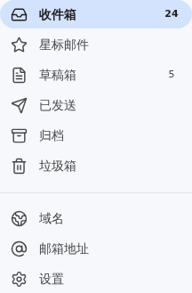

# Dependency upgrade and global cf migration

Worktree: `/root/Clouds/FlareMail-cf-cli`; branch: `chore/cf-cli-dependencies`.
Baseline: `ea4a0f47697f30ad59123cbee382fb6df2ca4fb9` (`origin/main`).
Validation: 2026-10-29, Bun 1.4.4, Node 24.22.1, global cf 1.0.0-beta.25.

## Result

Dependencies and the lockfile now use SvelteKit 3.1, Svelte 5.57, Vite 8.3, the Cloudflare adapter 8.0, PostalMime 4.1, Playwright 1.64 and axe 4.14. TypeScript uses 6.0.3: the SvelteKit compiler integration requires the JavaScript compiler API removed from TypeScript 7.

All project Cloudflare commands invoke global `cf`. The native Worker workspace packages fetch/email/scheduled and filtered client assets into Build Output. The official Svelte adapter's upstream Wrangler peer remains an internal compatibility library; there is no direct Wrangler CLI dependency or operational command. Typed cf configuration and local/private JSON targets replace the retired TOML configurations. Historical instructions remain archived.

## Local validation

- `bun install --frozen-lockfile`: PASS.
- `bun run test`: 661 passed, 0 failed (114 files, 4,100 assertions).
- `bun run check`: PASS, 0 Svelte diagnostics.
- `bun run build`: PASS, including native cf Build Output.
- `FLAREMAIL_CF_CONFIG=/does-not-exist-private-target.json bun run deploy:dry-run`: PASS. The offline path explicitly forces the public local target for both build stages and does not read the private target or upload.
- `bun run cf:typegen -- --check`: PASS; generated imports are normalized for the checked-in file location.
- `bun run audit:dependencies`: no high/critical vulnerabilities; one advisory below the high threshold remains in the audited graph (205 packages).
- Global cf local migrations, SQL column/row normalization, search-index verification and the maintenance report: PASS, using isolated D1/R2.
- Svelte HMR with the same isolated native cf state: login POST 200 and authenticated readiness 200/`ok=true`. The adapter proxy receives the public target's variables/bindings and the `v3` persistence directory.
- Public assets inspected: no server `_worker.js` or source maps.

Focused browser QA used repository Playwright because no Browser plugin was available. Every project ran serially with isolated fixture state under `/tmp/flaremail-e2e/cf-cli/` and the fake/demo provider:

| Project | Passed | Intentional project skips | Scope |
| --- | ---: | ---: | --- |
| Chromium desktop | 3 | 0 | accessible message states, WCAG, two-attachment reading |
| Chromium phone | 4 | 1 | HTML/CID/consent/report, states, WCAG, attachments |
| Chromium 320px | 2 | 3 | HTML and horizontal overflow |
| WebKit desktop | 4 | 0 | keyboard radios, login/navigation, HTML/CID, accessibility |
| WebKit phone | 3 | 1 | login/navigation, HTML/CID, touch/focus/accessibility |
| Firefox desktop | 3 | 0 | reading, keyboard radios, mobile viewport accessibility |

Earlier desktop checks also exercised login/logout, unread state, pagination, draft attachment races, upload/download and consent reports. Skips above belong to cases intentionally restricted to another project. Linux WebKit phone emulation is not real iOS/Safari evidence. These are focused scenarios, not a claim that the entire browser suite ran.

The axe upgrade exposed Label in Name issues. Message buttons now derive names from visible content with additional state/address metadata; navigation names include their visible badges and account names include visible initials. Visible layout is unchanged.

## Local review and remote boundaries

The initial `codex review --base origin/main` found three valid issues: child-environment typing, missing HMR bindings/persistence, and dropped SELECT result sets in the migration audit. All were fixed. The new audit regression uses two historical fixture users and an explicit cf batch; type checks and HMR/readiness validation cover the other fixes. Final review evidence records its exact head separately, avoiding a self-referential evidence commit.

No PRE or production code was deployed, no remote migration ran, and no real mail/Telegram was sent. Cloudflare metadata was read to verify the existing parent Worker; identifiers and variable values are excluded from committed evidence. PRE business acceptance and PR creation remain pending an existing Owner login/session and the reviewed private Preview setup. Health or build success is not PRE acceptance; preserve the task worktree/commit until this gate is complete.
