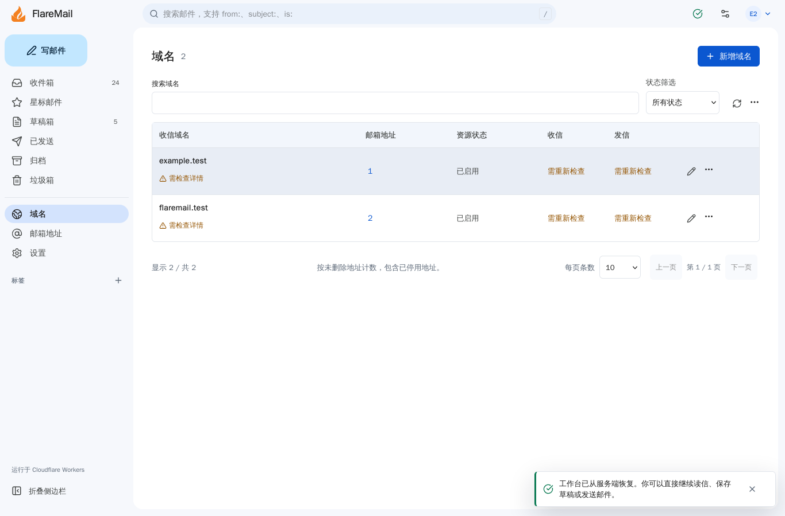

# cf CLI review follow-ups

Date: 2026-10-29. Worktree: `/root/Clouds/FlareMail-cf-cli`.
Branch: `chore/cf-cli-dependencies`; base: `ea4a0f47697f30ad59123cbee382fb6df2ca4fb9`.

The review of `ad3a84b` found two actionable issues:

- Migration wrappers dropped `--dry-run`. Both local and remote wrappers now
  preserve that flag and reject unknown options before invoking cf. Three
  subprocess regressions use a fake cf executable that records arguments and
  simulates a write. All three fail before the fix and pass afterward, with no
  real D1/API calls. Deployment instructions document the supported options.
- Domain-count button labels omitted their visible content under axe 4.14.
  They now derive names from their rendered text with screen-reader context.
  The attachment dropzone name also includes its visible limits text.

The broader browser replay found outdated test assumptions. A local address
creation can persist in D1 before missing routing credentials produce a 503.
The existing UI deliberately retains an uncertain outcome and blocks another
POST. The test now checks that contract, persisted visibility and no automatic
replay. Runtime write behavior was not relaxed. Navigation helpers now wait for
the applicable desktop/mobile control, and heading assertions allow existing
visible resource counts.

Firefox additionally exposed insufficient warning-text contrast on hovered
table rows. The light-theme warning token is darker, and the existing domain
accessibility scenario explicitly hovers a row before scanning it.

## Verification

- 683 Bun tests pass, 0 fail, 4,232 assertions in 116 files.
- Svelte/type check: 0 errors and 0 warnings. Both build stages pass.
- Generated types and public-target packaging checks pass.
- All 133 desktop scenarios are accounted for across serial continuations:
  125 passed and eight intentional project skips. Unaffected passes from the
  prior candidate were reused; failed cases and affected operations were
  rerun. Interrupted serial cases are not counted as passes or skips.
- The final domain-hover and primary-journey checks cover Chromium desktop,
  phone and 320px, WebKit desktop/phone and Firefox, including both themes.
  Eleven checks pass; one primary-journey case intentionally skips the 320px
  project. Firefox and phone screenshots were visually inspected.
  Exact results, validation head and command logs are recorded outside this
  worktree in the protected `FlareMail-evidence/cf-cli-dependencies/production`
  directory. Linux WebKit remains emulation, not a physical iPhone test.

Production publication records are kept separately from local/mock evidence.
No remote migration, real mail
or Telegram smoke was performed. Owner-authenticated PRE/production acceptance
remains unexecuted; the user explicitly accepted that stated limitation when
requesting production publication. Code and Security reviews remain required
before merging the task PR.
