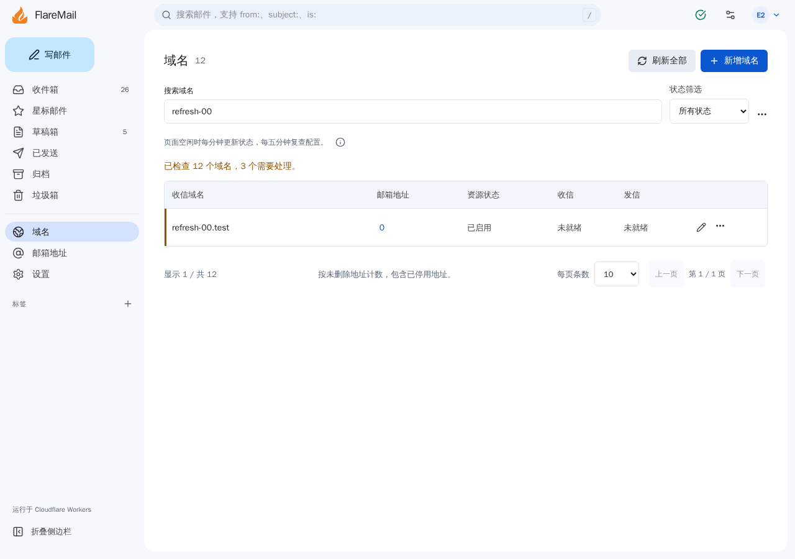
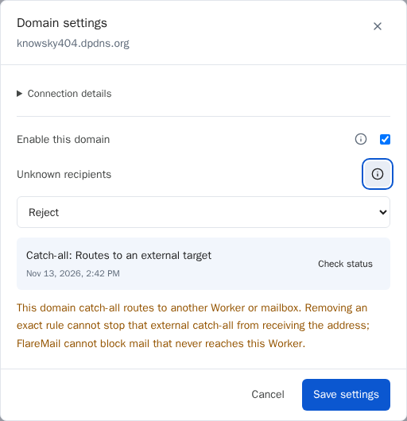
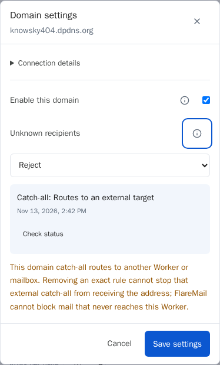

# 域名刷新与设置验收 — 2026-11-13

[SPEC](../specs/domain-refresh-and-settings.md)

基线为 `45920aa03229649d8d3bacd7407aa966ce3f7d9b`，任务分支为
`feat/domain-refresh-ui`，独立 worktree 为 `/tmp/FlareMail-domain-refresh`。
实现提交为 `8c4e9bccc9559e8b1df5af7d67947ff017bf5067`；后续提交补充本验收记录、截图及附件/草稿冲突及投递安全的中英文恢复建议，以及单域名恢复标记、失效 Collect 警告和批量失败详情。
最终 head、本地审查时间与结果、PRE 部署 ID 保存在源码外的任务证据中，PR 引用对应记录。

## 本地验证

- `bun run test`：911 通过，0 失败；`bun run check`：0 错误、0 警告。
- `bun run build`、`bun run deploy:dry-run` 通过。无新增依赖或数据库迁移。
- Chromium 桌面、手机及 320px 窄屏覆盖批量检查、部分失败、自动刷新暂停恢复、
  编辑草稿保留、英文错误与信息提示；相关 Firefox、WebKit 和无障碍验证通过。
- 自动读取与手动刷新竞争、供应商错误元数据变化、HTTP 200 内部失败、地址路由
  待处理状态及检查快照保留均有回归覆盖。
- 审查补充回归：单域名恢复后清除批量标记，Collect 已启用但 catch-all 禁用/丢弃时
  直接显示故障警告，HTTP 200 内部错误不再显示检查正常。五种浏览器/视口组合共 26 个相关场景通过。
- 批量请求被拒绝时按域名保留失败原因，诊断明确区分失败尝试与已保存观察；
  登录限流、Telegram 绑定等既有恢复步骤提供中英文提示。新增 15 个相关浏览器场景通过。
- Browser 插件不可用，使用仓库 Playwright。Linux WebKit 设备模拟不等于真实 iOS。

## 真实 PRE 验收

环境：[mail-ai PRE](https://mail-ai-flaremail.littlecontrol.workers.dev/)。
沿用独立 D1 和共享 R2 绑定，仅在独立 D1 创建并清理临时登录会话、接入获授权测试域名及
更新其检查元数据；未知地址策略保持 `reject`，未写共享 R2。

经单独授权创建仅限 `knowsky404.dpdns.org` 的 Token，权限为 **Zone Read**、
**Email Routing Rules Read**，仅安装到该 PRE 的 `CLOUDFLARE_EMAIL_ROUTING_READ_TOKEN`。
无密钥值写入源码、公开记录或命令输出，其他绑定和生产部署指向核对未变。

- 认证 readiness 的版本与验收提交一致；真实域名列表、桌面和手机设置页正常。
- 刷新全部实际调用检查接口，Cloudflare 状态为 `ready`，无供应商错误。
- 自动刷新接口完成一次真实供应商查询；立即重复时检查数量为 0，五分钟冷却有效。
- 该域名现有 catch-all 指向 `cloudflare_temp_email`，应用正确显示 `external`。
  保留现有邮件路由，未将它改指本应用。Collect 成功条件及错误文案由本地回归覆盖。
- 连接详情默认折叠，提示可聚焦并用 Escape 关闭；桌面和手机无溢出、无页面异常。
- 不存在域名的刷新请求返回 404；临时会话已删除，域名策略保持不变。
- PRE 未配置 Resend，显示 `not_configured` 属于预期结果。

未发布生产、未修改路由或 DNS、未执行远程迁移，未发送真实邮件、Telegram 或 AI 请求。
HTTP 检查不证明生产 `email()` 或 Cron 投递，相关观察逻辑采用本地测试验证。

## 截图

批量刷新截图来自本地合成数据；设置弹窗截图来自获授权的真实 PRE 测试域名。

