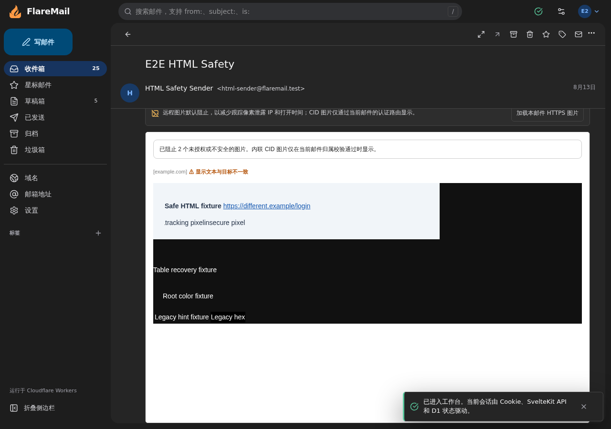

# HTML reader and global cf integration

Date: 2026-10-29. Worktree: `/root/Clouds/FlareMail-cf-cli`.
Branch: `chore/cf-cli-dependencies`; baseline: `ea4a0f47697f30ad59123cbee382fb6df2ca4fb9`.
The nine reviewed HTML reader commits from `fix/html-email-preview` are included
alongside the dependency and CLI migration. The original task worktree remains
available until the combined task is accepted and merged.

## Behavior

The reader preserves safe sender typography, table presentation, colors, legacy
HTML attributes, the CSS cascade and width media queries. HTML5 parsing repairs
malformed fragments before filtering. Scoped styles stay inside the sandbox;
scripts, forms, CSS resource loading and unauthorized external images remain
blocked. Outbound sanitization retains its separate conservative policy. The
approach and open source references are documented in both READMEs.

Integration exposed CSS Tree's runtime JSON loading when bundled by Vite 8.
Both app and Worker builds now resolve its official portable ESM distribution,
which embeds the grammar data. The actual bundled reader is exercised below.

## Local verification

- Frozen install: PASS.
- Bun tests: 680 passed, 0 failed, 4,220 assertions across 115 files.
- Type/Svelte checks: PASS, 0 errors and 0 warnings.
- App and native cf Worker build: PASS.
- Generated Worker types check: PASS.
- Public-target deploy dry run: PASS; no upload or private production target.
- Dependency audit: no high/critical findings; one advisory below the high
  threshold in the 210-package graph.
- The HTML reader browser scenario passes on Chromium desktop, phone and 320px,
  WebKit desktop and phone, and Firefox desktop: six passes. It checks actual
  colors/padding/width, repaired tables, border-box sizing, CID loading, remote
  image consent/revocation, keyboard switching and plain-text fallback. Every
  run uses isolated local D1/R2 and fixture mail. Linux WebKit is emulation, not
  evidence from a physical iPhone.
- Desktop and phone fixture screenshots were visually inspected. They contain
  synthetic test content only; the desktop screenshot is retained below.

## Remote and review boundaries

Global cf authentication and reads of existing Worker/D1/R2 metadata succeeded.
A read-only remote schema query returned version 28 and zero rows written.
An initial native Preview upload succeeded, its entry/login page and health
returned 200, and unauthenticated readiness correctly returned 401. The
production deployment pointer was unchanged. This establishes CLI operation,
not authenticated acceptance of the final integrated commit.

The native Preview has no inherited production secrets. The Preview guide now
documents this boundary and the version-preview alternative with preview-mode
variables and no production traffic switch. The final commit SHA, deployment
IDs/URLs, exact local review result and authenticated acceptance status are
recorded outside this worktree to avoid changing the commit being verified.
Owner credentials/session are still required for the PRE business gate. No
remote migration, fixture write, real mail/Telegram or production deployment
was performed. No functional PR may be created before that gate passes.
